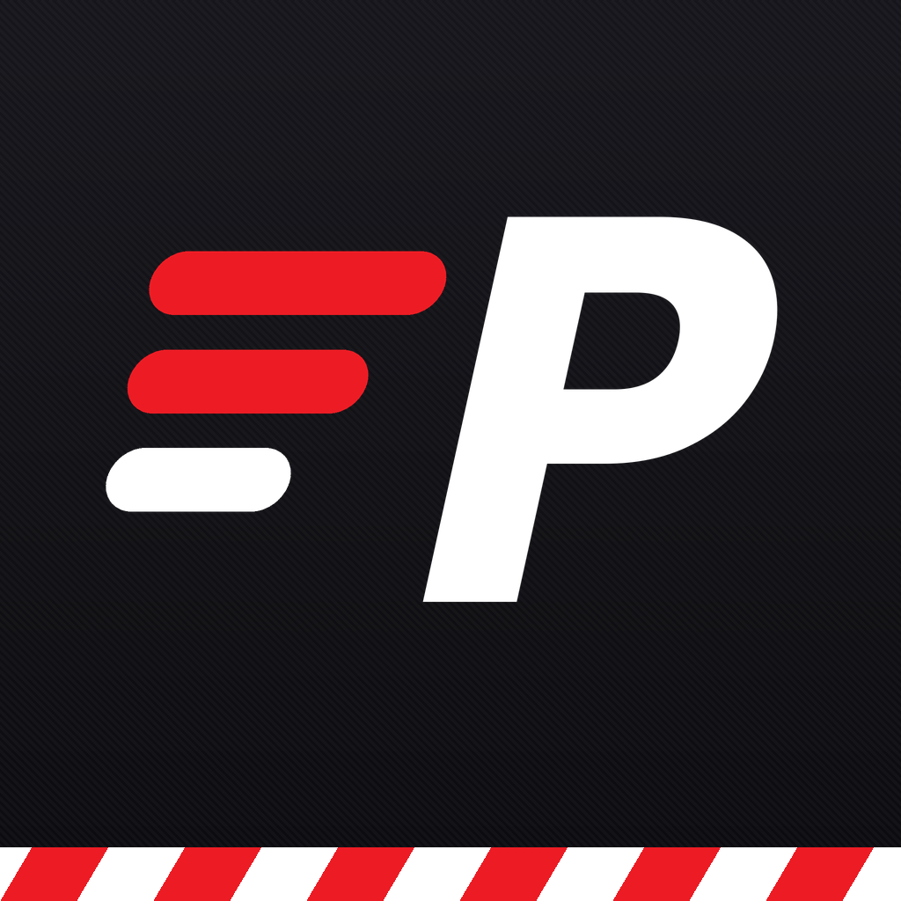
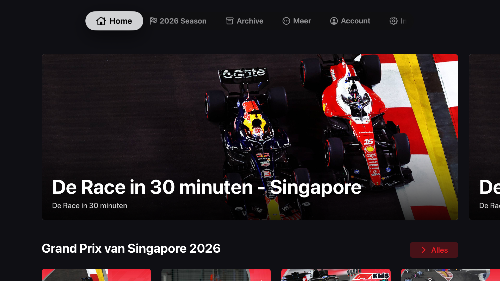
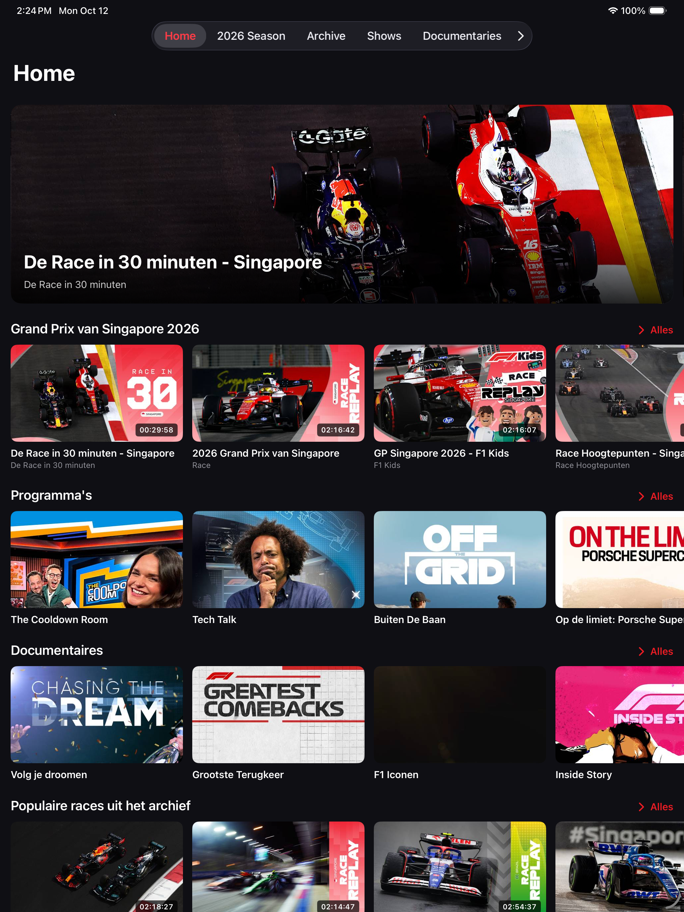
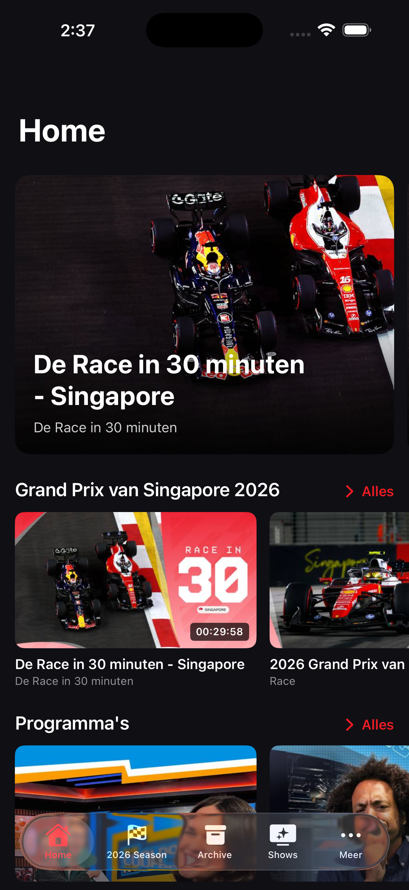

<p align="center">
  
</p>

<h1 align="center">Pitwall</h1>

<p align="center">
  Onofficiële F1 TV-app voor <b>Apple TV</b>, <b>iPhone</b>, <b>iPad</b> en <b>Mac</b>.<br>
  Live races, replays, onboards en multiview — met je eigen F1 TV-abonnement.
</p>

<p align="center">
  
  
  
</p>

## Screenshots

| Apple TV | iPad |
| --- | --- |
|  |  |

<p align="center"></p>

## Functies

- **Alles uit F1 TV** – Home, huidig seizoen, archief, shows en documentaires, rechtstreeks uit het F1 TV-menu.
- **Race-weekends** – sessieprogramma in je eigen tijdzone, met landvlaggen en rondenummer.
- **Alle feeds** – Internationaal, F1 Live, data- en trackerkanalen en de onboards van elke coureur.
- **Multiview** – tot 9 feeds tegelijk: Naast elkaar, Hoofd + 1, Hoofd + 3, 2 × 2 of 3 × 3.
- **Gekoppelde bediening** – pauzeren, 10 s terug/vooruit, terug naar live en alle feeds synchroniseren (op programmatijd).
- **Geluid volgt je keuze** – de geselecteerde tegel heeft geluid, per feed kies je de commentaartaal.
- **Setups** – sla je favoriete combinatie op en zet hem bij de volgende sessie in één keer terug.
- **4K HDR** – FairPlay-streams in de hoogste kwaliteit die je abonnement, toestel en scherm toelaten.
- **Live vanaf het begin** – of meteen naar de live-rand; of laat het telkens vragen.
- **Native per platform** – tvOS-transportbalk met feeds en multiview, picture-in-picture op iPhone/iPad, zijpaneel en sneltoetsen op de Mac.
- **Nederlands en Engels**.

## Pitwall-account

Pitwall heeft een eigen account (Supabase), net als Bingr. Daarmee:

- log je een **Apple TV** in met een **QR-code**: scan hem met je telefooncamera en bevestig in Pitwall, of vul de code in bij Account › Tv koppelen;
- gaan je **F1 TV-login, instellingen en multiview-setups** mee naar al je apparaten, via het account én iCloud;
- beheer je je **apparaten** (hernoemen, verwijderen; een verwijderd apparaat logt uit).

Het contract staat in [docs/ACCOUNT.md](docs/ACCOUNT.md), de backend in `supabase/`. De workflow *Backend* zet alles klaar zodra de repo-secrets `SUPABASE_ACCESS_TOKEN` en `SUPABASE_PROJECT_REF` er zijn.

## Inloggen bij F1 TV

**iPhone, iPad en Mac** – Account › *Inloggen met F1 TV*. Je logt in op de officiële F1-pagina; Pitwall bewaart alleen de sessie in je sleutelhanger, nooit je wachtwoord.

**Apple TV** – neemt de F1 TV-login automatisch over via je Pitwall-account of iCloud. Zonder account kan het ook rechtstreeks in je netwerk:

1. Open Pitwall op de Apple TV en ga naar **Account**. Er verschijnt een 6-cijferige code.
2. Open Pitwall op je iPhone, iPad of Mac › **Account** › **Naar Apple TV in dit netwerk**.
3. Kies de Apple TV en vul de code in.

De code is de sleutel van een versleutelde verbinding (TLS met pre-shared key) in je eigen netwerk; beide apparaten moeten op hetzelfde wifi zitten.

## Bouwen

Vereist **Xcode 16 of nieuwer**.

1. Open `Pitwall.xcodeproj`.
2. Kies het schema **Pitwall** en als bestemming een Apple TV, iPhone/iPad of *My Mac*.
3. Team staat op `EU3UY476T6`, bundle-ID `nl.lrvdlinden.pitwall`. Druk op ⌘R.

Het is één multiplatform-target: alle Swift-bestanden in `Pitwall/` horen automatisch bij elk platform (synchronized folder). Platformverschillen zitten in `#if os(...)`.

| Map | Inhoud |
| --- | --- |
| `Pitwall/Core/Networking` | HTTP-client, F1 TV-endpoints en JSON-modellen |
| `Pitwall/Core/Catalog` | Menu, pagina's en mapping naar app-modellen |
| `Pitwall/Core/Auth` | F1 TV-sessie, sleutelhanger, web-login en koppeling in je netwerk |
| `Pitwall/Core/Account` | Pitwall-account (Supabase), tv-koppeling en apparaten |
| `Pitwall/Core/Sync` | Sync van F1 TV-login, instellingen en setups via account en iCloud |
| `supabase/` | Database-schema en Edge Function `device-auth` |
| `Pitwall/Core/Playback` | Entitlements, FairPlay, feeds en multiview-sessie |
| `Pitwall/UI` | SwiftUI-schermen per onderdeel |
| `Tools/` | Scripts voor project, iconen en vertalingen |

Hulpscripts (Python 3 + Pillow):

```bash
python3 Tools/generate_project.py 2   # project opnieuw schrijven met buildnummer 2
python3 Tools/generate_assets.py      # app-iconen en tvOS top-shelf opnieuw maken
python3 Tools/generate_strings.py     # Engelse vertalingen bijwerken
```

GitHub Actions bouwt bij elke push voor iOS, tvOS en macOS. De workflow *Screenshots* (handmatig te starten) maakt nieuwe schermafbeeldingen in de simulators.

## Wijzigingen

Zie [CHANGELOG.md](CHANGELOG.md).

## Disclaimer

Pitwall is onofficieel en niet verbonden aan de Formula 1-bedrijven. Je hebt een eigen F1 TV-abonnement nodig; Pitwall bevat geen abonnement. Welke feeds, resolutie en HDR beschikbaar zijn hangt af van F1 TV, je abonnement, verbinding, toestel en scherm.

F1, FORMULA ONE, FORMULA 1, FIA FORMULA ONE WORLD CHAMPIONSHIP, GRAND PRIX en verwante merken zijn handelsmerken van Formula One Licensing B.V.
